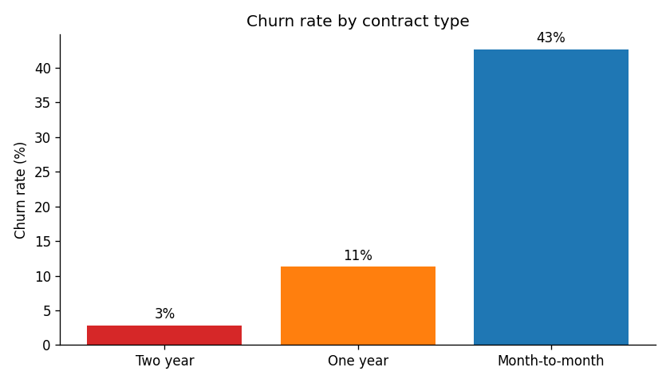
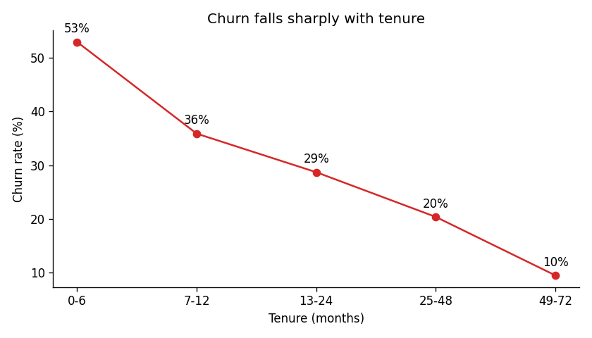
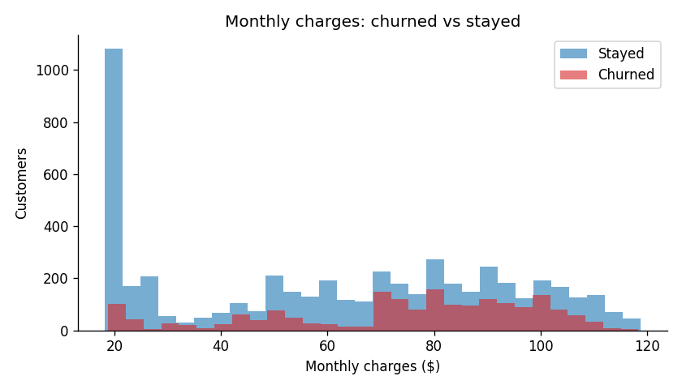
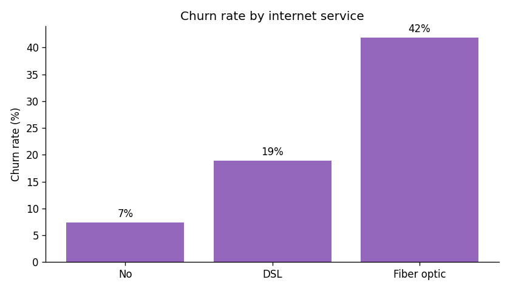
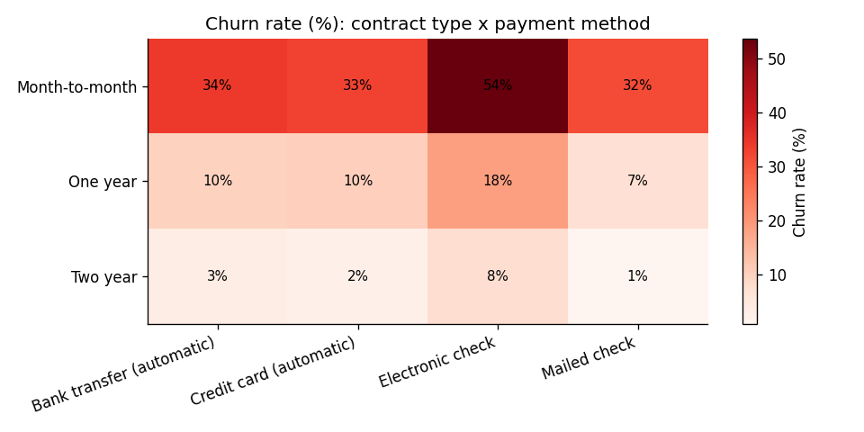

# Telco Customer Churn Analysis (Python, pandas, matplotlib)

A practice data-analysis project on the public IBM Telco Customer Churn dataset: **7,043 customers**, overall churn rate **26.5%**. No client data; the dataset is public and linked below.

## Overview

Cleaned the raw CSV (including the blank `TotalCharges` values for brand-new customers), then explored which segments churn the most: contract type, tenure, internet service, payment method and monthly charges.

## Tech

- Python (pandas)
- matplotlib
- Jupyter-style EDA script (`analysis.py`)

## Key findings

- **Month-to-month contracts churn at 42.7%**, vs 11.3% for one-year and 2.8% for two-year contracts
- Churn drops from **52.9%** in the first 6 months of tenure to **9.5%** after 4 years
- **Fiber-optic customers churn at 41.9%**, more than double DSL (19.0%)
- Churned customers skew toward **higher monthly charges**

## Charts







## Dataset

- [IBM Telco Customer Churn sample](https://github.com/IBM/telco-customer-churn-on-icp4d) (public)

## Run it

```bash
pip install pandas matplotlib
python3 analysis.py
```

Charts are written to `charts/`, and a segment summary to `charts/summary.csv`.

## Links

- Portfolio: [faresfolio-brehkes7.manus.space](https://faresfolio-brehkes7.manus.space)
- LinkedIn: [fares-mostafa-8812a4387](https://www.linkedin.com/in/fares-mostafa-8812a4387)
